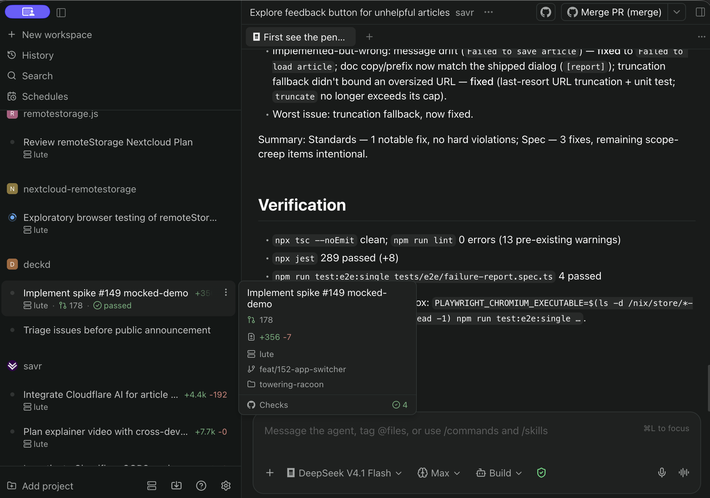
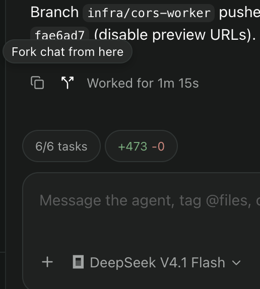

---
tags:
  - tech
title: Why Paseo is my daily driver
---

There is no shortage of [agentic workspaces](https://agentmgmt.dev/) these days. I do really love how there are so many different takes on the problems and solutions. Ah, open source, and the beauty of choice!

In some of my [recent posts](https://www.dgt.is/blog/2026-07-19-ai-dev-log), I have been on a quest to find functional AI orchestration web front-ends for my use, and it's sort of impossible to keep track of all the new ones that are always coming into existence. Several were probably birthed while I was writing the sentence.

For me, [Paseo](https://paseo.sh/) has the right balance of features (that actually work). It empowers me, gets out of my way, and is easy to access across all my devices/platforms. The project is live and kicking with thousands of stars, open discussions, and tickets.

I have spent the last few months using Paseo as my coding operating system, so I am familiar with all of its functionality and quirks. Here is a list of reasons (in order of importance to me) why Paseo has been my favorite tool.

## It gives me a stateful workspace for all ongoing work

All my projects and sessions are there. All the time. If the agents are not running, they are essentially conversations ready for me to continue on whenever I am ready. No more need to start the IDE and get reacquainted with what I was doing. No Terminal/Tmux connection needed. This is what the web was made for. The context is literally all there, ready to go, like I never left. It's like my Firefox, with 100 stateful tabs. I can dive into an old topic right wherever I left off when I am ready.

## Forking is amazing!

I use it several times a day. I'm not sure what I would do without this superpower. When evaluating a plan the LLM often tells me things to be aware of, or what will bite me later outside of the topic of what I am currently working on. Sometimes I will have it write that to a ticket to pick up later. But it's even easier to have it fork off the conversation into a new session and pick that new subject up right then and there.

I use these for other side quests all the time. It's also the only way I know of to switch agents midstream. You can switch models in the same session, but if you need to switch from Claude to Opencode, that won't work unless you fork.

## Authentication is simple

Maybe I'm missing the point, but most of [these services ship with a control plane](https://github.com/slopus/happy/tree/main/packages/happy-server), or some kind of middleman service to help with remote access. These additional processes mostly get in my way. I particularly [don't like](https://github.com/pingdotgg/t3code/discussions/6867) T3's solution, [which relies on a hosted broker with account limits](https://github.com/pingdotgg/t3code/blob/main/docs/user/remote-access.md). I would prefer to manage my network how I like. Tailscale gets this job done on its own without hand-holding.

## The terminal and scrolling actually works on mobile

This is something most of these projects fail at. When I try a new project that has web terminal support, this is the first thing I check. Along with how the keyboard special keys work. Suffice to say, none of them work out of the box ([like no one bothered to check](https://github.com/siteboon/claudecodeui/issues/908)), except Paseo. Continuing my theme of Paseo impressions - things just work. I'm not filing a bug report within 10 minutes of trying it. No surprises.

While I rely less and less on terminals when working with agents, dependence on worktrees has made these integrated terminals particularly important. This is because finding where that worktree directory is not always easy, and just starting the in-session terminal solves that and more if you use the integrated Paseo worktree hooks.

## Client/server version mismatches gracefully degrade

This is just not an assumption most client/server architectures support. And I have been very pleasantly surprised that Paseo handles this so well, because my server and phone may be running different versions - forward or behind. This is one of those features I took for granted until I was setting up T3 and found that it was not so forgiving. I had to do some serious gymnastics to keep them in lock step.

## Low connectivity, no problem

I do a lot of work while on a train with a spotty connection as I go in and out of tunnels. Sure, the server can't respond in those cases, but many of these services halt the client entirely in this case. This is completely unnecessary and bad UX.

Claude Web is particularly bad at this. Not only does a weak connection cripple the client, it also affects the server. If the agent is plugging away and my connection drops it can mess up the server side process as well. This should not be an issue. When I fire off a prompt I should be able to close my phone and come back later to see what happened on the host.

In Paseo, the page stays open where I can review all the discussion from the running session, and more importantly, type into the message box. Then when the connection is up, the server will get it. I don't need to wait for a full connection before even starting to type. This is a simple thing for any productivity app to get right.

## Multi-host support works great

I have Paseo set up across operating systems, architectures, agents, models. `npx` gets you 95% there. NixOS is my main driver, which can be complex for new services, but this simple base service does not need a bunch of special architecture to get going.

I can quickly point my client to a series of hosts in my Tailscale and immediately get going. Onboarding is a snap and this is important for me since I work from many devices (home desktop, work laptop, phone, tablets).

## Room for improvement

After spending months with Paseo as my primary driver, I can't help but notice the quirks that bite me here and there. Here are some current ongoing issues/discussions that are important to me. Though I'm pretty sure they will work out over time.

* More comprehensive usage/hourly limits across models/agents. The global across agents is pretty good, but I have needed to build patches/plugins for [handling non-Claude agents like MiniMax](https://github.com/getpaseo/paseo/discussions/3304) when viewing directly in chat.
* [Landscape mode on mobile](https://github.com/getpaseo/paseo/discussions/2729). The history shows that this was hard code disabled at some point. Sometimes I need a wide view when viewing ASCII diagrams for example.
* [Better organization tools](https://github.com/getpaseo/paseo/discussions/4487) for [managing large amounts of threads](https://github.com/getpaseo/paseo/discussions/4495#discussioncomment-18414047).
* Moving threads between agents/models would be great, but I would like a [way to move across hosts](https://github.com/getpaseo/paseo/discussions/3377) too. This has come up recently for me more so as I work on a [project](https://github.com/jonocodes/deckd) that has platform specific needs. I have the Paseo service running on a Mac and Linux box, which I need to switch back and forth between.
